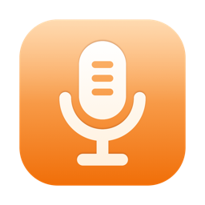
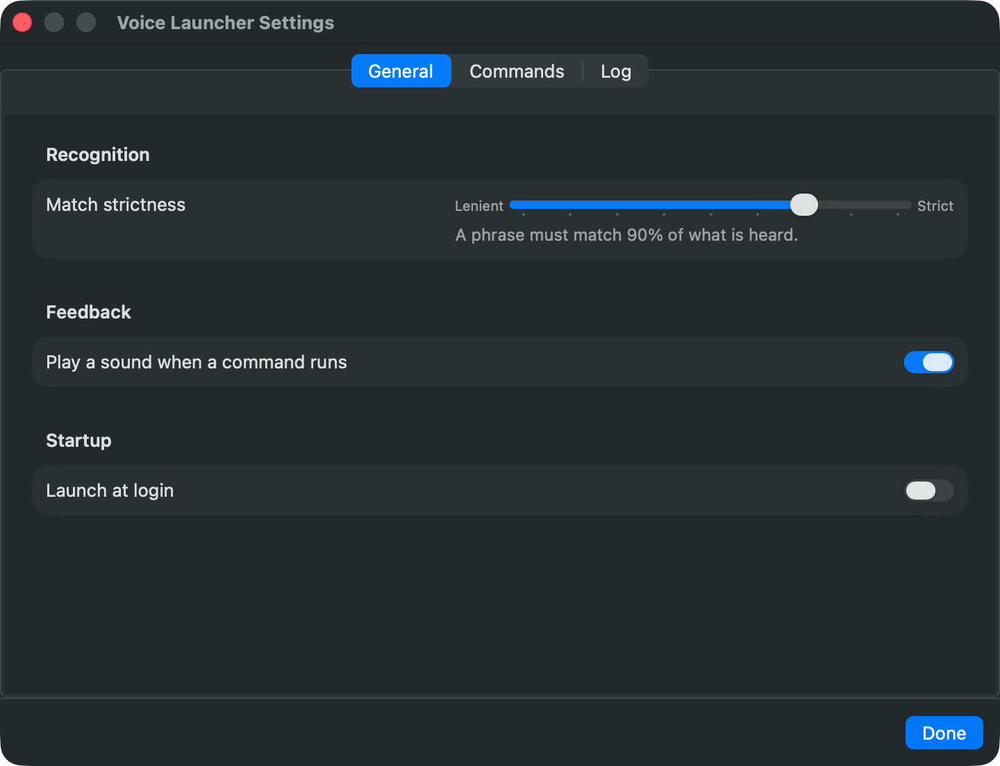

<h1 align="center">Voice Launcher</h1>

<p align="center">
  A macOS menu-bar app that runs an action when it hears one of your phrases —
  and <b>never types a word</b>.
</p>

<p align="center">
  <a href="https://github.com/umkasanki/voice-launcher/releases/latest"></a>
  <a href="https://github.com/umkasanki/voice-launcher/releases"></a>
  
</p>

<p align="center">
  
</p>

Say *"Hey Mac, start tracking"* and your head tracker starts. Say *"Hey Mac,
restart tracking"* and it restarts. Phrases are plain text you type in; each one
opens, quits or restarts an app, or runs a Shortcut.

Built for someone who drives the Mac with a head tracker and cannot reach for
the keyboard. macOS Voice Control can run such commands too, but while it is on
it also types what it hears — so every sentence dictated elsewhere comes out
twice. Voice Launcher only listens for commands. It never produces keystrokes,
so it runs happily alongside any dictation tool.

---

## How it works

1. **Listen** — the microphone is transcribed continuously, on this Mac, with
   Apple's speech recognition.
2. **Match** — each transcript is compared with your phrases. The match is
   fuzzy: a swapped letter, another word form, or a name written in the other
   alphabet still counts.
3. **Run** — once you pause for a moment, the best match runs, a sound
   confirms it, and the transcript starts afresh.

With a **key phrase** — *"Hey Mac"*, say — a command runs only when the key
phrase is said first and the command follows right after it. Ordinary speech
that merely contains a command word does nothing.

---

## Features

| Action | What it does |
|--------|--------------|
| Open app | Launches the app, or brings it to the front |
| Quit app | Asks it to quit, as the Dock does; sends SIGTERM if it is still running after five seconds |
| Restart app | Quit, then open |
| Run Shortcut | Runs a Shortcut by name |
| Pause / Resume listening | While paused, only a resume phrase is acted on |

- **Test a phrase** before relying on it: the editor shows what was heard and
  the match score, and **Use Heard Text** copies the recogniser's version into
  the phrase.
- **Strictness** is adjustable (90% by default). Two commands that score too
  close to call — "on" and "off" said indistinctly — run nothing.
- **Sounds** confirm a command (Glass), an error (Basso), pause (Bottle) and
  resume (Pop). They play through the alert-sound device, so they are heard on
  the Mac even while music plays on a speaker elsewhere.
- **Log** of what was heard and what ran. What was merely heard stays in
  memory; only commands, state changes and errors are written to
  `~/Library/Logs/VoiceLauncher.log`.
- **Microphone comes and goes** — unplug the USB microphone and Voice Launcher
  waits quietly, then resumes when macOS reports one again.
- **Launch at login**, and it lives in the menu bar — no Dock icon.

<p align="center">
  
</p>

---

## Install

**[Full installation guide →](docs/INSTALL.md)** — what Homebrew is, what to do
when macOS blocks the app, and which permissions it asks for.

### Homebrew — recommended

```bash
brew tap umkasanki/tap
brew trust umkasanki/tap          # third-party taps are trusted once
brew install --cask voice-launcher
```

Then open Voice Launcher and allow the **microphone** and **speech
recognition** when macOS asks.

### .dmg — if you cannot use Homebrew

Download `VoiceLauncher-<version>.dmg` from the
[latest release](https://github.com/umkasanki/voice-launcher/releases/latest),
open it, and drag Voice Launcher into Applications.

**macOS will refuse the first launch.** The app is signed by me rather than by
Apple, so the refusal is expected. Allow it in **System Settings → Privacy &
Security → Open Anyway**, then open the app again — step by step in the
[installation guide](docs/INSTALL.md#method-2--the-dmg-file).

<details>
<summary><b>Build from source</b></summary>

No Xcode project needed — the app is assembled with the Command Line Tools.

```bash
git clone git@github.com:umkasanki/voice-launcher.git
cd voice-launcher

./App/setup-signing.sh        # once: stable signature, so permissions survive rebuilds
./App/build-app.sh --install  # build, copy to /Applications, launch
swift test                    # matcher tests
```

</details>

---

## Requirements

- macOS 14+
- A microphone (a Mac mini has none built in — a USB one works)
- **Microphone** and **Speech Recognition** permission
- Recognition language: Russian, on-device. The matcher itself is language-agnostic.

## Privacy

Speech is recognised on this Mac (`requiresOnDeviceRecognition`); audio and
transcripts never leave it. Transcripts are not stored on disk.

---

## For maintainers

<details>
<summary><b>Cutting a release</b></summary>

Releases are automated by [`.github/workflows/release.yml`](.github/workflows/release.yml).
Push a version tag and the workflow builds the `.dmg`, publishes a GitHub
Release, and bumps the Homebrew cask in `umkasanki/homebrew-tap`:

```bash
git tag v0.2.0 && git push origin v0.2.0
```

Repo secrets: **`TAP_TOKEN`** — a fine-grained token with **Contents: Read and
write** on `homebrew-tap` only; **`SIGNING_P12_BASE64`** and
**`SIGNING_P12_PASSWORD`** — the self-signed identity from
`App/setup-signing.sh`, so the microphone grant survives updates.

Manual fallback: `./App/make-dmg.sh` builds `build/VoiceLauncher-<version>.dmg`
and prints its SHA-256; upload it to a Release and edit the cask by hand — see
[packaging/homebrew/voice-launcher.rb](packaging/homebrew/voice-launcher.rb).

App icon: edit `tools/AppIcon.svg`, mirror it in `tools/make-icon.swift`, and
rebuild `App/AppIcon.icns`.

</details>

<details>
<summary><b>Project structure</b></summary>

```
Sources/VoiceLauncherCore/   command model and phrase matcher (no UI, unit-tested)
Sources/VoiceLauncher/       menu-bar app: listener, actions, settings window
Tests/VoiceLauncherCoreTests matcher tests
App/                         Info.plist, icon, build-app.sh · make-dmg.sh · setup-signing.sh
tools/                       icon source (SVG) and its CoreGraphics renderer
packaging/homebrew/          cask template
docs/                        installation guide, references
```

</details>

---

## Credits

Projects studied before choosing the design are listed in
[docs/REFERENCES.md](docs/REFERENCES.md).
